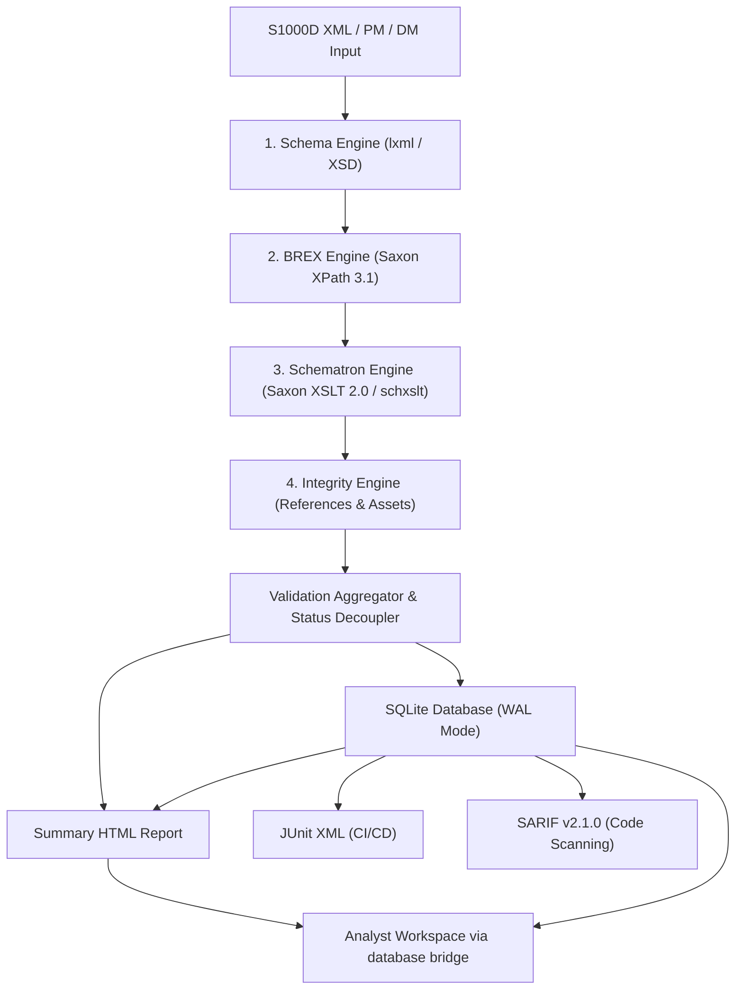
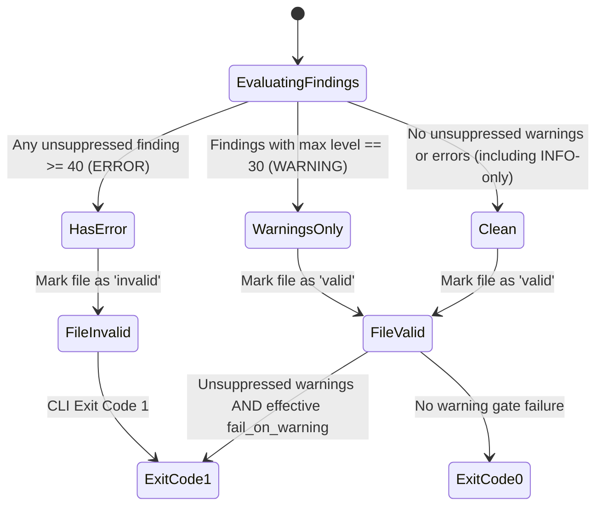
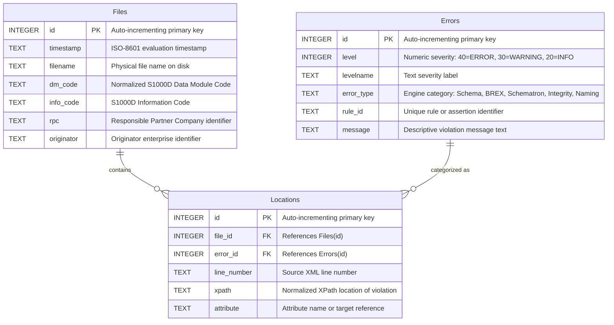

# S1000D Validation Suite - Technical Specification (v8.7.0)

The **S1000D Validation Suite** validates batches of S1000D XML publications. It provides multiple validation stages, SQLite persistence, a browser dashboard, JUnit XML and SARIF v2.1.0 exports, and a desktop user interface. DMC means Data Module Code, ICN means Information Control Number, and CSDB means Common Source Data Base.

---

## 1. Multi-Stage Validation Architecture

The validator processes XML Data Modules (DMs) and Publication Modules (PMs) through four decoupled, pipelined validation stages:



### Stage Summary

| Stage | Engine / Technology | Scope & Responsibilities | Default Status |
| :--- | :--- | :--- | :--- |
| **1. Schema** | `lxml.etree` (W3C XSD) | Structural and syntactic conformance against official S1000D XML schemas. Enforces schema version matching. | Enabled |
| **2. BREX** | `Saxon-C (XPath 3.1)` | Business Rule Exchange. Evaluates contextual and structural rules (`structureObjectRule`), notation constraints (`notationRuleList`), and value constraints against target documents. | Enabled |
| **3. Schematron** | `Saxon-C (XSLT 2.0 via schxslt)` | ISO/IEC 19757-3 Schematron rules compiled into XSLT pipelines. Extracts granular rule, pattern, and assertion IDs from SVRL reports. | Enabled |
| **4. Integrity** | Reference and resource resolver | Verifies internal references (`<internalRef>`), inter-DM links (`<dmRef>`), publication module links (`<pmRef>`), and physical illustration/multimedia resources (ICN files). | Enabled |

---

## 2. File Validity & Severity Decoupling Model

Starting with **v8.7.0**, the system implements a strict decoupling between **Rule Severity** and **File Validity**:

### Severity Levels
- **`ERROR` (Level 40)**: An unsuppressed violation at level 40 or higher marks the file as `invalid`.
- **`WARNING` (Level 30)**: An advisory finding that does not invalidate the file. It affects the batch exit status when the effective `fail_on_warning` setting is enabled.
- **`INFO` (Level 20)**: Informational metrics, naming metadata, and auditing observations.



> [!IMPORTANT]
> **Batch exit policy**: After processing, invalid files produce exit code 1. Otherwise unsuppressed warnings produce exit code 1 only when `fail_on_warning` is enabled through CLI or settings; other completed batches exit 0. File validity is independent of this gate. Configuration audits are a separate preflight step: level >= 40 aborts with code 1 normally; `--strict-config` lowers that audit threshold to 30. These rules describe the validator's exit status, not downstream CI decisions. SQLite retains INFO/WARNING/ERROR findings; individual report formats have different retention rules (Section 8).

---

## 3. Engine Specifications & Features

### 3.1 Schema Engine (XSD)
- **Pre-compilation**: S1000D schemas in the schema directory are scanned and pre-compiled once at startup to accelerate high-volume batch validation.
- **Resolution Modes (`--schema-mode`)**:
  - `local`: Resolves schemas strictly from the specified local schema folder. No internet access is attempted.
  - `online`: Downloads missing HTTP(S) schema locations and caches them locally; the resolver does not enforce an official-domain allowlist.
  - `auto` *(Default)*: Searches the local schema folder first; falls back to online caching if missing.
- **S1000D Version Guard (`--allowed-versions`)**:
  - Accepts comma-delimited S1000D versions (e.g., `4.1,4.2`).
  - Rejects documents referencing unauthorized schema versions with `S1000D_VERSION_VIOLATION`.

### 3.2 BREX Engine (Saxon XPath 3.1)
- **XPath 3.1 Standard**: Powered by Saxon-C (`saxonche`), supporting modern XPath functions, maps, arrays, and regexes.
- **Execution Modes (`--brex-mode`)**:
  - `project` *(Default)*: Evaluates all BREX files found in the configuration directory and any discovered BREX DMs in the input folder against all DMs.
  - `chain`: Traverses `<brexDmRef>` reference hierarchies recursively, executing only BREX rules specifically linked in the document's chain.
  - `ignore`: Executes reference chain traversal but suppresses `BREX_MISSING` errors for absent referenced BREX modules.
- **Universal & URN Context Support**: Fully parses and matches BREX `@rulesContext` attributes specified as URNs (e.g., `urn:s1000d:ident:dml:...`), universal wildcards, or flat schema file names.
- **Notation Validation**: Supports `<notationRuleList>` checking; validates declared notations against XML `<!NOTATION ...>` declarations.
- **Flag Conformance**: BREX `allowedObjectFlag="1"` violations respect custom `brex_severity` configuration.

### 3.3 Schematron Engine (ISO-Schematron / schxslt)
- **Pipeline Architecture**: Transforms ISO Schematron files (`.sch`) into executable XSLT 2.0 stylesheets using `schxslt` skeleton transforms, executed directly in Saxon-C.
- **Granular Rule ID Extraction**: Discovers rule IDs using a four-tier fallback hierarchy:
  1. `svrl:failed-assert/@id`
  2. `preceding-sibling::svrl:fired-rule[1]/@id`
  3. `preceding-sibling::svrl:active-pattern[1]/@id`
  4. Root Schematron file name.

### 3.4 Integrity Engine (References & External Manifest)
- **Inter-DM References (`<dmRef>`)**: Flags missing data modules with `LINK_BROKEN`.
- **Publication References (`<pmRef>`)**: Flags missing publication modules with `PM_LINK_BROKEN`.
- **Internal Fragment References (`<internalRef>`)**: Validates internal references against element `id` targets in the same document; flags missing targets with `INTERNAL_LINK_BROKEN`.
- **Resource Integrity (`RES_MISSING`)**: Checks for physical existence of ICN illustrations and multimedia assets on disk.
- **Fuzzy Suggestions**: Utilizes `difflib` sequence matching to recommend valid candidate targets (`"Did you mean: DMC-..."`).
- **External CSDB Manifest (`--csdb-manifest`)**: Treats listed modules and resources as available during partial deliveries. This is caller-supplied inventory, not independent verification of the central repository. The caller is responsible for completeness and freshness.

#### Manifest records and matching

JSON objects accept `dmcs`/`modules` lists and `resources`/`icns` lists, for example:

```json
{"dmcs": ["DMC-EXT-A000-00-00-0000-00A-040A-D"], "resources": ["ICN-EXAMPLE.svg"]}
```

A JSON list is also accepted: entries beginning with `ICN-` are resources, and other entries are modules. Text and CSV-like inputs accept identifiers separated by commas, semicolons, or tabs; blank lines and lines beginning with `#` are ignored. Use records without headers. This is delimiter splitting with surrounding quote removal, not a general CSV parser supporting quoted delimiters.

Module matching removes DMC/PMC/DMLC prefixes, uppercases identifiers, and discards suffixes after the first underscore. Text records also strip file extensions; use bare module codes in JSON. Resource matching uses uppercase filename stems. Holdings augment DM/PM reference and resource checks; they cannot resolve same-document internal IDs. Missing files return empty holdings; parse exceptions are swallowed and can return empty or partially accumulated holdings, so verify inventory before use.

---

## 4. Configuration Architecture & Settings

### 4.1 Modular Configuration Directory Layout (`config/`)

The validation suite enforces a clean separation of concerns between executable engine code and project-specific business rules. The directory supplied via `-c / --config` (defaulting to `./config`) contains all rule definitions, schema files, and engine parameters:

- **Official Baseline Rules**:
  - `DMC-S1000D-A000-00-00-0000-00A-022A-D_001-00_EN_US.XML`: The canonical standard S1000D Default Business Rules Exchange (BREX) module from the official specification.
  - `S1000D_Business_Rules.sch`: Neutral Schematron rules enforcing fundamental naming and authoring conventions (file name alignment, non-empty titles, ICN pattern conformance).
  - `schemas/`: Complete local library of official W3C XML Schema definitions (`.xsd`).
  - `schxslt/`: Official ISO Schematron compilation stylesheets.
  - `validator_settings.json`: Central policy file controlling engine switches and severities.

### 4.2 Project & Enterprise BREX Layering

S1000D mandates hierarchical rule layering. Organizations customize validation rules without modifying the repository codebase:
1. **Tier 1 (Specification Default)**: Standard S1000D Default BREX (`DMC-S1000D-...`).
2. **Tier 2 (Enterprise Baseline)**: Organization-level rules applicable across all fleet programs (e.g., `DMC-CORPGEN-...`).
3. **Tier 3 (Program / Project Layer)**: Specific weapon system or equipment rules (e.g., `DMC-PROJECTX-...`).

Custom enterprise and project-specific BREX files placed into `config/` (or passed via `-c <path>`) are evaluated automatically in `project` or `chain` mode. The repository's `.gitignore` explicitly filters proprietary BREX data modules to prevent inadvertent commits of customer or program-sensitive rules.

### 4.3 Engine Settings (`validator_settings.json`)

Project rules, severity mappings, and engine policies are governed by `validator_settings.json`:

```json
{
    "engines": {
        "schema":     { "enabled": true,  "severity": "ERROR" },
        "brex":       { "enabled": true,  "severity": "ERROR" },
        "schematron": { "enabled": true,  "severity": "ERROR" },
        "integrity":  {
            "enabled": true,
            "severity": "WARNING",
            "reference_checks": { "enabled": true },
            "resource_checks": { "enabled": true }
        }
    },
    "schema_mode": "auto",
    "allowed_s1000d_versions": ["4.1", "4.2"],
    "strict_config": false
}
```

### Static Configuration Audit & Self-Check
- Audits all configured BREX and Schematron rules against compiled S1000D schemas prior to scanning datasets.
- Warns on dead rules (e.g., XPath queries targeting non-existent elements/attributes).
- If `--strict-config` is active, any audit warning aborts execution before file batch processing.

### Effective settings and CLI precedence

Settings are loaded from the selected configuration directory and normalized before merging. Precedence depends on the option:

| Option | Current merge behavior |
| --- | --- |
| Engine disable flags | A CLI disable flag wins; otherwise settings supply enablement. There is no CLI force-enable override for a disabled configured engine. |
| Schema mode | Settings replace a parsed `auto` value, even when `--schema-mode auto` was explicitly supplied. Other CLI modes take precedence. |
| Allowed versions | A nonempty CLI list wins; otherwise `allowed_s1000d_versions` supplies the list. No restriction is applied if neither supplies a value. |
| Strict configuration / warning gate | Either the positive CLI flag or a true configured value enables the policy. There is no inverse CLI flag. |
| Manifest path | A CLI path wins; otherwise the configured `csdb_manifest` is used. |

For example, omitting `--allowed-versions` preserves the settings example's `4.1,4.2` restriction. A configured schema mode of `local` also replaces an explicit CLI `auto`; this merge cannot distinguish explicit default-valued arguments from omitted arguments.

---

## 5. Error Baseline & Suppression (`baseline.json`)

Known or accepted project deviations can be suppressed using regular-expression matching rules in `baseline.json`:

```json
{
    "ignores": [
        {
            "error_type": "Integrity",
            "rule_id": "INTERNAL_LINK_BROKEN",
            "dm_code": "DMC-JP-.*",
            "xpath": ".*",
            "message": ".*"
        }
    ]
}
```

### Suppression Matching Keys
All provided keys must match for a violation to be suppressed (logical `AND`):
- `error_type` *(Optional)*: Engine type (`Schema`, `BREX`, `Schematron`, `Integrity`, `Naming`, `Config`).
- `rule_id` *(Optional)*: Specific rule or assertion identifier (e.g., `BRDP-AH-42038JP`, `RULE-TOP-01`, `LINK_BROKEN`).
- `dm_code` *(Optional)*: Regex targeting specific Data Module Codes.
- `xpath` *(Optional)*: Regex matching the XPath location.
- `message` *(Optional)*: Regex matching the error message text.

---

## 6. Command Line Interface (CLI) Specification

### Entrypoint
```bash
python S1000D_XML_Processor.py -i <input_dir> -c <config_dir> [options]
```

### Argument Reference

| Flag | Argument Type | Default | Description |
| :--- | :--- | :--- | :--- |
| `-i`, `--input` | Path | *Required* | Directory containing XML files or data modules to validate. |
| `-c`, `--config` | Path | *Required* | Configuration directory containing BREX XMLs, `.sch` rules, and `validator_settings.json`. |
| `-l`, `--log-dir` | Path | `logs` | Destination directory for databases, logs, and generated reports. |
| `-s`, `--schema-dir` | Path | `config/schemas` | Directory containing S1000D W3C `.xsd` schema files. |
| `--schema-mode` | `local` \| `online` \| `auto` | `auto` | XSD schema resolution strategy. |
| `--allowed-versions` | Comma-separated list | `None` | Restricts validation to allowed S1000D versions (e.g., `4.1,4.2`). |
| `-w`, `--max-workers` | Integer | CPU Count | Number of concurrent multiprocessing worker processes. |
| `-b`, `--baseline` | Path | `None` | Path to `baseline.json` rule suppression file. |
| `--csdb-manifest` | Path | `None` | Path to master CSDB manifest file (TXT/CSV/JSON) for asset link resolution. |
| `--fail-on-warning` | Flag | `False` | Exit with status `1` if any unsuppressed `WARNING` (level 30) findings occur. |
| `--brex-mode` | `project` \| `chain` \| `ignore` | `project` | BREX rule resolution mode. |
| `--no-schema` | Flag | `False` | Disable XML Schema (XSD) validation engine. |
| `--no-brex` | Flag | `False` | Disable Business Rule Exchange (BREX) engine. |
| `--no-sch`, `--no-schematron` | Flag | `False` | Disable ISO-Schematron validation engine. |
| `--no-integrity` | Flag | `False` | Disable all link and resource integrity checks. |
| `--no-reference-checks` | Flag | `False` | Disable inter-DM, publication, and internal link checking. |
| `--no-resource-checks` | Flag | `False` | Disable illustration and multimedia asset checking. |
| `--strict-config` | Flag | `False` | Abort validation if configuration audit contains warnings. |
| `--debug` | Flag | `False` | Enable verbose debug logging to console. |
| `--no-html` | Flag | `False` | Skip generation of summary HTML report. |
| `--xml` | Flag | `False` | Generate machine-readable legacy XML report. |
| `--junit` | Flag | `False` | Generate standard JUnit XML report (`[date]_junit.xml`) for CI/CD test viewers. |
| `--sarif` | Flag | `False` | Generate OASIS SARIF v2.1.0 JSON report (`[date]_sarif.json`) for code scanning. |
| `--csv` | Flag | `False` | Export database records directly to CSV format. |
| `--txt` | Flag | `False` | Output valid and invalid file lists as plain text. |
| `--log` | Flag | `False` | Save console output to timestamped process log file. |
| `--version` | Flag | `False` | Display application version and exit. |

### Performance Optimization
- **Dynamic Chunking**: Worker chunk size is computed dynamically:
  `chunksize = max(1, min(50, total_files // (workers * 4)))`
  uses integer division and caps each chunk at 50 files. Utilization depends on file cost, worker count, and available resources; this formula is not a throughput guarantee.
- **Lazy Saxon XML Parsing**: Saxon XML document models are only instantiated when the BREX or Schematron engines are active, avoiding overhead when running pure schema/integrity passes.

---

## 7. Relational Database Persistence (SQLite)

Validation runs stream results into an ACID-compliant SQLite database (`[timestamp]_validation.db`) running under **WAL (Write-Ahead Logging)** mode.



### Database Integrity Rules
- `Errors` enforces `UNIQUE(error_type, rule_id, message)` to ensure normalized storage and deduplicated violation counts.
- Foreign keys relate records; indices (`idx_loc_file`, `idx_loc_error`) support joins and lookups. Query latency depends on workload and hardware; no fixed response-time guarantee is specified.

---

## 8. Enterprise CI/CD & Reporting Formats

### 8.1 Summary HTML Report & Local Database Transfer
The summary report (`[timestamp]_report.html`) is a standalone document containing overall metrics, error distribution bars across all categories (Schema, BREX, Schematron, Integrity, Naming), and an embedded Base64-encoded `postMessage` bridge.
For databases strictly smaller than 25 MiB, the generator embeds the database as Base64 in the summary. The local report responds to the viewer's `postMessage` request with this payload, avoiding a database fetch through a `file://` URL and requiring no local web server. At or above the limit, select or drag the database file into the viewer manually. Browser memory and popup policies still constrain operation.

### 8.2 JUnit XML (`--junit`)
Produces a standard JUnit XML file (`[timestamp]_junit.xml`) compatible with GitLab CI, GitHub Actions, and Azure DevOps test dashboards:
- `<testsuite>` encompasses all processed files.
- Level `40` (ERROR) violations are serialized as `<failure>` nodes.
- WARNING and INFO findings are omitted from JUnit. Warning-only files remain passing test cases even if the CLI warning gate makes the batch exit 1. Consumers may apply their own pipeline policy.

### 8.3 OASIS SARIF v2.1.0 (`--sarif`)
Produces a standard Static Analysis Results Interchange Format (SARIF) JSON report (`[timestamp]_sarif.json`):
- Supported natively by GitHub Advanced Security and SonarQube.
- Maps `error_type` and `rule_id` to SARIF `rules[]`.
- Maps file paths, line numbers, and XPath contexts directly into `results[].locations[]`.
- Retains warning findings as `warning` and informational findings as `note`; XPath is included in the result message. SQLite and CSV also retain these findings, whereas JUnit omits them.

---

## 9. Analyst Workspace (`S1000D_App_Viewer.html`)

A serverless, client-side single-page application built on `sql.js` (WebAssembly SQLite):
- **Reactive Insights Dashboard**: Charts and KPIs dynamically recalculate based on active faceted sidebar filters (`FILTERED_INDICES`).
- **Tri-State Faceted Filters**: Allows Including (`+`), Excluding (`-`), or Ignoring neutral categories across Error Type, Severity, RPC, Originator, and Rule IDs.
- **Diagnostics Drawer Quick Actions**:
  - `📋 Copy DMC`: Copies normalized DMC to clipboard.
  - `📋 Copy XPath`: Copies violation XPath.
  - `📋 Copy Baseline Rule JSON`: Generates a drop-in JSON suppression object ready for insertion into `baseline.json`.
- **Valid Files Inspection**: Dedicated tab with full omni-search, sorting, and pagination for files that passed validation with zero errors.

---

## 10. Graphical User Interface (`validator_gui.py`)

A desktop application built in Python Tkinter (`s1000d_validator.gui`):
- **Library Verification**: Pre-flight verification of required native dependencies (`saxonche`, `lxml`).
- **Persistent Preferences**: Saves and loads last-used directories and flags from `.validator_history.json`.
- **Validation and Reporting Controls**: Configures schema modes, BREX modes, CSDB manifests, baseline files, and report formats (HTML, CSV, JUnit, SARIF). Allowed-version and strict-config controls are not exposed in the GUI; use the CLI or configuration file for these policies.
- **Process Control**: Non-blocking asynchronous execution thread with interactive console, native `ttk.Progressbar`, and **"⏹ Stop"** button to abort running batches cleanly.
- **One-Click Report Opener**: Launches the most recent summary report in the default system browser upon completion.

---

## 11. Repository Workflow

Developers work in local checkouts and synchronize through a shared Git repository. Machine-specific setup is documented in README.md. The canonical `config/` directory contains BREX rules, Schematron, XSD schemas, and settings; legacy configuration clones and release archives are excluded from tracking.

## 12. Operational Constraints and Trust Boundaries

- The viewer loads sql.js, Chart.js, and fonts from external CDNs, including the sql.js WebAssembly runtime. Serverless operation therefore does not imply offline availability. Manual database loading does not remove these dependencies.
- Summary and viewer message handlers currently inspect message type/content without authenticating the sender's origin or window identity, and use wildcard destinations. Use reports and the viewer in a trusted browsing context; the bridge is not an authenticated channel.
- Core lxml parsers disable DTD loading and network access, but the schema resolver separately downloads HTTP(S) schemas in auto/online modes. Local mode disables those downloads. These parser settings do not establish a sandbox for Saxon XPath/XSLT rules; use trusted configuration and rule files.
- Schema lookup uses local names and cached paths. The implementation does not provide a domain allowlist or a general isolation boundary for untrusted deliveries. Do not assume local-path or executable-rule containment from the schema mode alone.
- Invalid manifest input can silently contribute no holdings. Invalid settings parsing prints a diagnostic and continues with defaults. Review startup diagnostics and use validated configuration inputs.
- Embedded reports duplicate database content as Base64; browser decoding adds memory overhead. No maximum supported batch size or fixed query latency is guaranteed. Use manual loading when embedding is unavailable; very large databases remain subject to browser memory limits.

## 13. Current Architectural Trade-offs

The hybrid parser stack uses lxml for XSD validation/source locations and Saxon for XPath/XSLT capabilities. This supports the required rule languages but introduces two native dependencies and potentially two document representations. Lazy Saxon parsing reduces overhead when its engines are disabled.

SQLite provides a portable interchange file shared by reporting and browser analysis. Browser loading requires the WebAssembly runtime and enough memory for the dataset. A hosted database could support different deployment and capacity requirements but would add a service to operate; no such deployment is specified here.

Embedding a small database makes report-to-viewer transfer convenient over local file URLs at the cost of larger HTML and additional memory. Manual loading avoids embedding and the message bridge but requires a separate user action. These are present-day trade-offs, not claims about historical decisions.
